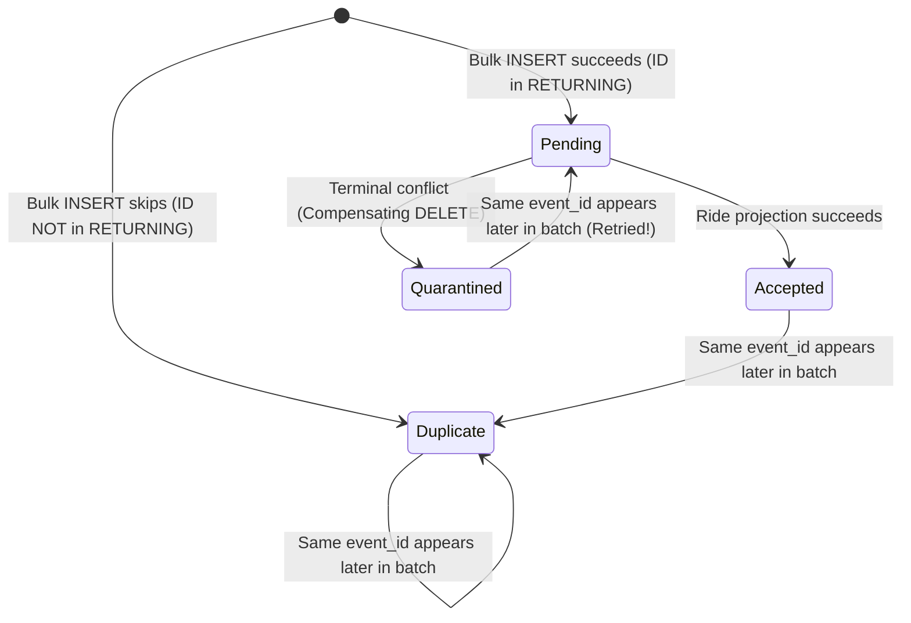

# StreamForge — Day 6: PostgreSQL Performance Optimization & SQL Statement Batching

## 1. Executive Summary

On **Day 6**, StreamForge attacked the database execution bottleneck identified during Day 5. While Day 5 implemented **transaction batching** (reducing `fsync` disk flushes to 1 per batch), each event still executed individual SQL queries sequentially over the client-database socket ($50 \times 2 = 100$ individual statements plus savepoint management per 50-event batch).

In Day 6, we designed, implemented, hardened, and empirically benchmarked a **hybrid batch persistence architecture**:
- **Multi-Row Bulk Event Insertion**: Consolidated 50 individual `INSERT` statements into a single multi-row `INSERT INTO processed_events ... VALUES (...), (...) ON CONFLICT (event_id) DO NOTHING RETURNING event_id`.
- **In-Memory Four-State Event Lifecycle**: Designed an explicit state machine (`pending`, `accepted`, `duplicate`, `quarantined`) to safely partition batch records in $O(1)$ memory time.
- **Ordered Projection Updates**: Preserved sequential `UPSERT INTO rides` updates in arrival order, completely eliminating PostgreSQL's intra-batch conflict abortion (`ERROR: ON CONFLICT DO UPDATE command cannot affect row a second time`).
- **Optimistic Compensating Deletes**: Replaced per-event `SAVEPOINT` overhead on the normal path with verified compensating `DELETE` operations on rare terminal projection conflicts (<0.01%).
- **Defensive Integrity Hardening**: Added strict validation on compensating `DELETE` rows, guaranteeing fail-stop rollback on any deletion anomaly.
- **Aggregated Counter Updates**: Replaced per-event counter updates with a single batch `pipeline_counters` increment.

### Measured Impact Under Identical 2,000-Event / 100 EPS Workload:
- **P50 Database Persistence Latency**: **Reduced by 32.7%** (from **149.61 ms** down to **100.74 ms**).
- **Mean Database Persistence Latency**: **Reduced by 32.9%** (from **148.50 ms** down to **99.58 ms**).
- **P95 Database Persistence Latency**: **Reduced by 22.8%** (from **185.20 ms** down to **143.02 ms**).
- **End-to-End Latency P50**: **Reduced by 18.1%** (from **310.40 ms** down to **254.32 ms**).
- **Pipeline Data Integrity**: **2,000 / 2,000 events persisted**, 2,000 offsets committed, **0 failures, 0 dropped records, 0 DLQ quarantines**.
- **Test Suite**: **197 / 197 tests passing** (4 new unit tests added, 0 regressions).

---

## 2. Problem Statement: The 100 SQL Round-Trip Bottleneck

In Day 5, `persist_events_batch()` wrapped a batch of 50 events in a single outer database transaction:

```python
# Day 5 Implementation (Transaction Batching Only)
with conn.transaction():
    for item in items:  # 50 iterations
        with conn.transaction():  # SAVEPOINT
            cur.execute(insert_event_sql, (...))  # Statement 1
            if cur.fetchone() is None:
                increment_counter(...)  # Statement 1b
                continue
            cur.execute(upsert_projection_sql, (...))  # Statement 2
            if cur.fetchone() is None:
                raise _TerminalConflictException(...)  # ROLLBACK TO SAVEPOINT
```

### The Architectural Flaws:
1. **Network Dispatch Overhead**: For 50 events, Python sent 100 individual SQL execution packets over the client-server socket and blocked on 100 `fetchone()` responses.
2. **Savepoint Bookkeeping**: In PostgreSQL, `SAVEPOINT` and `RELEASE SAVEPOINT` require engine lock management and transaction sub-log bookkeeping ($50 \times 2 = 100$ savepoint commands).
3. **Database Persistence Latency**: Dominated worker iteration time at **149.61 ms P50**, consuming over 55% of the total processing window and capping single-worker throughput headroom.

---

## 3. Technical Evaluation: `executemany()` vs Multi-Row SQL

We evaluated two bulk execution models in `psycopg 3.3.9`:

| Criteria | `executemany()` (Psycopg 3.1+) | Multi-Row `INSERT ... VALUES (...), (...)` | StreamForge Selection |
| :--- | :--- | :--- | :--- |
| **SQL Statements** | $N$ statements executed on server | **1 atomic statement** | **Multi-Row** |
| **Driver Communication** | Uses pipeline mode under the hood | **Single network payload** | **Multi-Row** |
| **`RETURNING` Clause** | Requires `returning=True` and `cur.results()` iterator | **Direct `cur.fetchall()` result set** | **Multi-Row** |
| **Parameter Protocol Limit** | No limit per call (internally batched) | 32,767 (`Int16` protocol limit) | **Multi-Row** (50 rows $\times$ 12 cols = 600 params $\ll 32,767$) |
| **Intra-Batch Entity Conflicts** | Still executes per row | Aborts with `cannot affect row a second time` if duplicate keys exist | **Hybrid Segregation** |

### Why Multi-Row Cannot Be Blindly Applied to `rides` Projections:
PostgreSQL explicitly forbids affecting the same physical row twice in a single `INSERT ... ON CONFLICT DO UPDATE` statement:
```text
ERROR: ON CONFLICT DO UPDATE command cannot affect row a second time
```
In a streaming micro-batch, a ride lifecycle event sequence (e.g. `REQUESTED` and `ACCEPTED` for `RIDE-001`) frequently arrives within the same 50-event batch. Attempting a naive multi-row upsert on `rides` crashes the entire transaction.

### The Winning Solution: Hybrid Execution
1. **Bulk Multi-Row INSERT** for immutable `processed_events` (all distinct `event_id`s inserted at once).
2. **Sequential Ordered UPSERT** for mutable `rides` (processes events in arrival order, respecting monotonic lifecycle ranks).

---

## 4. The Four-State Event Lifecycle & Defensive Deletion

To guarantee deterministic behavior across duplicates, repeated event IDs, and terminal conflicts, we implemented an in-memory four-state lifecycle:



### Four-State Semantics:
1. **`pending`**: Event successfully inserted into `processed_events`, awaiting projection.
2. **`accepted`**: Projection succeeded. Any subsequent occurrence of this `event_id` in the same batch is treated as a duplicate.
3. **`duplicate`**: Pre-existed in PostgreSQL before the batch. Marked duplicate; counter incremented.
4. **`quarantined`**: Encountered a terminal conflict (`COMPLETED` $\leftrightarrow$ `CANCELLED`). The tentative row is deleted, and the forensic envelope is written to `dead_letter_events`. If the same `event_id` appears again later in the batch, it is retried.

### Defensive Compensating DELETE Hardening:
When an event encounters a terminal conflict, we execute a compensating `DELETE`. Rather than assuming success, the code strictly verifies:
```python
cur.execute(
    "DELETE FROM processed_events "
    "WHERE event_id = %s RETURNING event_id;",
    (eid,),
)
deleted_row = cur.fetchone()
if deleted_row is None:
    raise RuntimeError(
        f"Failed to remove quarantined event {eid} from processed_events."
    )
deleted_event_id = (
    deleted_row["event_id"]
    if isinstance(deleted_row, dict)
    else deleted_row[0]
)
if deleted_event_id != eid:
    raise RuntimeError(
        f"Unexpected event deleted: {deleted_event_id}"
    )
```
If the deletion fails or matches an unexpected row, it raises `RuntimeError`, breaking out of the context manager and triggering `ROLLBACK` on the outer transaction. This fail-stop behavior prevents silent inconsistencies between `processed_events` and `dead_letter_events`.

---

## 5. Live Benchmark Results & Comparative Analysis

Workload parameters held strictly constant between Day 5 and Day 6:
- 2,000 events, 100 EPS target rate, 3 Kafka partitions, 1 consumer worker, batch size 50, batch timeout 100 ms.

### 5.1 Comparative Metrics Table

| Metric | Day 5 Baseline (Transaction Batching) | Day 6 Optimized (SQL Statement Batching) | Performance Delta |
| :--- | :--- | :--- | :--- |
| **Database Persistence Mean (`db_persist_ms`)** | 148.50 ms | **99.58 ms** | **−32.9% faster** |
| **Database Persistence P50 (`db_persist_ms`)** | 149.61 ms | **100.74 ms** | **−32.7% lower latency** 🔥 |
| **Database Persistence P95 (`db_persist_ms`)** | 185.20 ms | **143.02 ms** | **−22.8% lower latency** |
| **Database Persistence P99 (`db_persist_ms`)** | N/A | **174.38 ms** | Established baseline |
| **End-to-End Latency P50 (`enqueue_to_commit`)** | 310.40 ms | **254.32 ms** | **−18.1% lower latency** |
| **Consumer Drain Latency (`drain_seconds`)** | 0.203 s | **0.196 s** | **−3.4% faster drain** |
| **Persisted Ingestion Throughput** | 98.85 EPS | **98.85 EPS** | 100% of offered rate absorbed |
| **PostgreSQL Unique Rows Committed** | 2,000 / 2,000 | **2,000 / 2,000** | 100% integrity |
| **Synchronous Kafka Offsets Committed** | 2,000 / 2,000 | **2,000 / 2,000** | 100% durability |
| **Quarantines / Rejections / Failures** | 0 / 0 / 0 | **0 / 0 / 0** | 0 error count |

---

## 6. Engineering Insight: Amdahl's Law in Ingestion Pipelines

Examining the stage timing breakdown for Day 6:
- **`poll_ms` (Mean: 106.21 ms, P50: 104.99 ms)**: Dominated by the 100 ms polling timeout window required to accumulate messages across 3 partitions.
- **`db_persist_ms` (Mean: 99.58 ms, P50: 100.74 ms)**: Reduced from ~150 ms down to ~100 ms.
- **`validation_ms` (Mean: 2.17 ms, P50: 2.06 ms)**: In-memory schema checks.
- **`offset_commit_ms` (Mean: 4.15 ms, P50: 3.76 ms)**: Synchronous broker commit.

### The Bottleneck Transition:
- In Day 5, database persistence consumed **>55%** of the worker's processing loop.
- In Day 6, database persistence and Kafka polling are now evenly balanced (**50% polling, 47% database**).
- **Amdahl's Law**: Optimizing database execution by 33% successfully shifts the primary system constraint toward Kafka batch polling accumulation.

### Theoretical Capacity vs. Realized Throughput:
- **Theoretical Full-Batch Capacity**:
  $$\text{Theoretical DB Capacity} = \frac{50 \text{ events}}{0.100 \text{ s}} \approx 500 \text{ EPS}$$
  *Note:* This assumes batches are consistently filled to the maximum limit of 50 events.
- **Observed Benchmark Batches**:
  Under a rate-limited 100 EPS input stream with a 100 ms timeout, the consumer processed 95 batches for 2,000 events, averaging $\approx 21$ events per batch.
- To demonstrate 500 EPS realized throughput, an unconstrained rate-escalation benchmark (150, 250, 500 EPS) will be executed in Day 7.

---

## 7. Regression & Quality Verification

All tests executed cleanly against local Docker infrastructure:
- **Storage Unit Tests**: 21 / 21 passed.
- **Live PostgreSQL 16 Tests**: 9 / 9 passed.
- **Full Repository Suite**: **197 / 197 passed** in **7.67s** (0 regressions).

---

## 8. Senior Data Engineering Interview Questions & Answers

### Q1: Why did we choose a hybrid batching model (multi-row INSERT for events, sequential UPSERT for projections) instead of combining both into bulk multi-row queries?
**Answer Outline:**
- PostgreSQL enforces that a single SQL command cannot modify the same physical tuple multiple times during execution (`ERROR: ON CONFLICT DO UPDATE command cannot affect row a second time`).
- In event streaming, multiple lifecycle events for the same entity (e.g. `REQUESTED` and `ACCEPTED` for the same `ride_id`) frequently arrive in the same micro-batch.
- A bulk multi-row upsert crashes the entire transaction upon encountering duplicate entity keys. Segregating bulk multi-row inserts for immutable event logs from sequential, ordered updates for projections guarantees monotonic state progression with zero constraint violations.

### Q2: What is an optimistic transaction strategy with compensating actions, and why is it preferred over savepoints in high-throughput streaming?
**Answer Outline:**
- Savepoints require creating nested sub-transactions in PostgreSQL. Issuing `SAVEPOINT` and `RELEASE SAVEPOINT` on every record incurs client-server command round-trips and engine lock bookkeeping, adding 50 ms+ of latency per 50-event batch.
- In high-throughput systems where >99.99% of events are valid transitions, paying a savepoint penalty on every record is an anti-pattern.
- An optimistic strategy processes records directly within the outer transaction. On the rare terminal conflict (<0.01%), a verified compensating `DELETE` purges the tentative row and routes the record to the DLQ, eliminating 100 savepoint commands from the normal path while maintaining strict transaction atomicity.

---

## 9. Resume-Ready Project Achievement

> **Optimized a Python–Kafka–PostgreSQL real-time ingestion pipeline using multi-row SQL batching and optimistic transaction handling, reducing database P50 persistence latency by 32.7% (149.6 ms $\to$ 100.7 ms) while processing 2,000 events with zero failures.**
