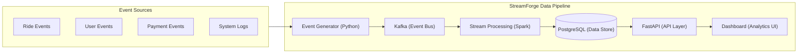

# StreamForge ⚡

> **Turn Streaming Events Into Actionable Intelligence.**  
> An end-to-end, fault-tolerant real-time event streaming and operational analytics platform.


---

## 🌟 Overview

**StreamForge** is an enterprise-grade real-time event streaming platform built for high-throughput, low-latency data engineering. It ingests continuous event streams, applies schema validation and deduplication, persists data idempotently, and surfaces live metrics and pipeline observability on unified dashboards.

### Key Capabilities
- **High-Throughput Ingestion:** Ingest 100K+ events/sec with sub-millisecond KRaft-backed Kafka event buses.
- **Stream Processing & Validation:** Stateful transformations, monotonic state validation, and enrichment using Apache Spark.
- **Idempotent Storage:** Clean, structured data persistence in PostgreSQL with `ON CONFLICT DO NOTHING` guarantees.
- **Fault Tolerance & DLQ:** Automated retries with exponential backoff and persistent Dead Letter Queue (DLQ) routing for corrupted payloads.
- **Real-Time Dashboards:** Dynamic volume charts, cohort metrics, pipeline health gauges, and live event inspection.

---

## 🛠️ Technology Stack

| Component | Technology | Purpose |
|---|---|---|
| **Event Generator** | Python (3.11+) | Synthesizes realistic event streams with UUIDv4 envelopes |
| **Message Broker** | Apache Kafka (KRaft) | Scalable, ordered, partition-keyed message ingestion |
| **Stream Processing** | Apache Spark (PySpark) | Windowed aggregations, deduplication, and anomaly checks |
| **Storage & Persistence** | PostgreSQL | Relational storage for analytics tables and DLQ payloads |
| **API Layer** | FastAPI | High-performance asynchronous REST telemetry layer |
| **Frontend UI** | React 19, Vite, Tailwind CSS v4 | High-fidelity interactive landing page and live dashboard |
| **Animations** | Framer Motion | Smooth springs, waveform pulses, and telemetry transitions |
| **Containerization** | Docker & Docker Compose | Multi-container reproducible orchestration |

---

## 🏗️ System Architecture



---

## 🚀 Getting Started

### Prerequisites
- **Node.js**: v18+ (v20+ recommended)
- **npm** or **pnpm** / **yarn**

### Quick Start (Frontend Landing & Dashboard)

1. **Clone the repository:**
   ```bash
   git clone https://github.com/shashwatbikramsingh/StreamForge.git
   cd StreamForge
   ```

2. **Install dependencies:**
   ```bash
   npm run setup
   # or: cd landing && npm install
   ```

3. **Start local development server:**
   ```bash
   npm run dev
   ```
   Open [http://localhost:5173](http://localhost:5173) in your browser.

4. **Production Build & Preview:**
   ```bash
   npm run build
   npm run preview
   ```

---

## 📂 Project Structure

```
StreamForge/
├── landing/                    # React + Vite + Tailwind v4 web app
│   ├── src/
│   │   ├── components/         # Modular landing page sections & modals
│   │   │   ├── Navbar.tsx
│   │   │   ├── Hero.tsx
│   │   │   ├── DashboardMockup.tsx
│   │   │   ├── TechStack.tsx
│   │   │   ├── ProblemSolution.tsx
│   │   │   ├── FeaturesGrid.tsx
│   │   │   ├── HowItWorks.tsx
│   │   │   ├── SystemArchitecture.tsx
│   │   │   ├── ProductPreview.tsx
│   │   │   ├── UseCasesAndReliability.tsx
│   │   │   ├── DocsAndPricing.tsx
│   │   │   ├── CtaBanner.tsx
│   │   │   ├── Footer.tsx
│   │   │   ├── Modals.tsx
│   │   │   └── BackgroundGradients.tsx
│   │   ├── App.tsx             # Main layout assembly
│   │   └── main.tsx
│   ├── package.json
│   └── vite.config.ts
├── streamforge_docs/           # Architecture and design specifications
│   ├── design.md
│   └── RULES.md
├── PRODUCT.md                  # Product requirement document
├── DESIGN.md                   # Visual system specification
├── package.json                # Root proxy scripts
└── README.md
```

---

## 📄 License
This project is licensed under the MIT License - see the LICENSE file for details.
