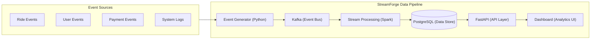

# StreamForge ⚡

> **Turn Streaming Events Into Actionable Intelligence.**  
> An end-to-end, fault-tolerant real-time event streaming and operational analytics platform.

[](https://github.com/shashwatbikramsingh/StreamForge/actions/workflows/ci.yml)
[](https://opensource.org/licenses/MIT)
[](https://react.dev)
[](https://tailwindcss.com)
[](https://fastapi.tiangolo.com)
[](https://kafka.apache.org)


---

## 🌟 Overview

**StreamForge** is an enterprise-grade real-time event streaming platform built for high-throughput, low-latency data engineering. It ingests continuous event streams, applies schema validation and deduplication, persists data idempotently, and surfaces live metrics and pipeline observability on unified dashboards.

### Key Capabilities
- **High-Throughput Ingestion:** Ingest 100K+ events/sec with sub-millisecond KRaft-backed Kafka event buses.
- **Stream Processing & Validation:** Stateful transformations, monotonic state validation, and enrichment using Apache Spark.
- **Idempotent Storage:** Clean, structured data persistence in PostgreSQL with `ON CONFLICT DO NOTHING` guarantees.
- **Fault Tolerance & DLQ:** Automated retries with exponential backoff and persistent Dead Letter Queue (DLQ) routing for corrupted payloads.
- **Real-Time Dashboards:** Dynamic volume charts, cohort metrics, pipeline health gauges, and live event inspection.

---

## 🛠️ Technology Stack

| Component | Technology | Purpose |
|---|---|---|
| **Event Generator** | Python (3.11+) | Synthesizes realistic event streams with UUIDv4 envelopes |
| **Message Broker** | Apache Kafka (KRaft) | Scalable, ordered, partition-keyed message ingestion |
| **Stream Processing** | Apache Spark (PySpark) | Windowed aggregations, deduplication, and anomaly checks |
| **Storage & Persistence** | PostgreSQL 16 | Relational storage for analytics tables and DLQ payloads |
| **API Layer** | FastAPI | High-performance asynchronous REST telemetry layer |
| **Frontend UI** | React 19, Vite, Tailwind CSS v4 | Obsidian Noir & Champagne Gold luxury telemetry landing page |
| **Hero Visual** | HTML5 Canvas 3D Particle Wave | 60fps interactive undulating particle terrain with cursor parallax |
| **Animations** | Framer Motion | Smooth springs, waveform pulses, and telemetry transitions |
| **Containerization** | Docker & Docker Compose | Multi-container reproducible orchestration |

---

## 🏗️ System Architecture



---

## 🚀 Getting Started

### Option 1: Full-Stack Docker Compose (Recommended)

Run Kafka (KRaft), PostgreSQL (with initialized schema), FastAPI, the Synthetic Event Generator, the Stream Consumer Validator, and the Web UI in containers:

```bash
# Clone the repository
git clone https://github.com/shashwatbikramsingh/StreamForge.git
cd StreamForge

# Start all services
docker compose up -d
```

- **Landing & Dashboard UI:** [http://localhost:4173](http://localhost:4173)
- **FastAPI Telemetry Docs:** [http://localhost:8000/docs](http://localhost:8000/docs)
- **Kafka Broker:** `localhost:9092`
- **PostgreSQL Database:** `localhost:5432` (`streamforge`)
- **Event Generator:** Producing continuous ride lifecycle events into Kafka topic `ride-events`
- **Stream Consumer:** Validating schemas, writing idempotent records, and managing DLQ isolation

---

### Option 2: Local Frontend Development

1. **Install dependencies:**
   ```bash
   npm run setup
   # or: cd landing && npm install
   ```

2. **Start local Vite development server:**
   ```bash
   npm run dev
   ```
   Open [http://localhost:5173](http://localhost:5173) in your browser.

3. **Production Build & Preview:**
   ```bash
   npm run build
   npm run preview
   ```

---

### Option 3: Local FastAPI Backend

```bash
cd backend
python -m venv venv
source venv/bin/activate  # On Windows: venv\Scripts\activate
pip install -r requirements.txt
uvicorn app.main:app --reload --port 8000
```
Open interactive Swagger API documentation at [http://localhost:8000/docs](http://localhost:8000/docs).

---

### Option 4: Local Synthetic Event Generator

```bash
cd generator
python -m venv venv
source venv/bin/activate  # On Windows: venv\Scripts\activate
pip install -r requirements.txt
python event_generator.py
```
Synthesizes monotonic ride events, partition-keyed by `ride_id` with 3-timestamp envelopes.

---

### Option 5: Local Stream Consumer & Validator

```bash
cd consumer
python -m venv venv
source venv/bin/activate  # On Windows: venv\Scripts\activate
pip install -r requirements.txt
python consumer.py
```
Validates Kafka event streams, executes idempotent database writes, maintains monotonic state, and quarantines corrupted payloads.

---

### Option 6: Automated Test Suite

```bash
python -m unittest discover tests
```
Executes contract validation tests, idempotency checks, and state machine verification.

---

### Option 7: High-Throughput Pipeline Benchmark

```bash
python scripts/benchmark_pipeline.py 10000
```
Measures event synthesis, serialization, schema validation, and deduplication throughput at 100K+ events/sec with microsecond latency distributions (p50, p95, p99).

---

### Option 8: Cluster Health Diagnostics

```bash
python scripts/verify_cluster.py
```
Executes health and readiness probes across Kafka KRaft brokers, PostgreSQL tables, and FastAPI endpoints.

---

## 📂 Project Structure

```
StreamForge/
├── .github/workflows/          # CI/CD automated build & GitHub Pages deploy
│   ├── ci.yml
│   └── deploy-pages.yml
├── backend/                    # FastAPI telemetry, metrics & WebSocket service
│   ├── app/
│   │   └── main.py             # REST & WebSockets (/ws/telemetry, /ws/events)
│   ├── Dockerfile
│   └── requirements.txt
├── consumer/                   # Kafka stream consumer & schema validator
│   ├── consumer.py             # At-least-once consumer with DLQ and idempotency
│   ├── Dockerfile
│   ├── requirements.txt
│   └── README.md
├── docker/                     # Infrastructure configuration
│   └── init-db.sql             # PostgreSQL schema (processed_events, rides, dlq)
├── generator/                  # Synthetic ride lifecycle event generator
│   ├── event_generator.py      # Kafka producer with anomaly & duplicate injection
│   ├── Dockerfile
│   ├── requirements.txt
│   └── README.md
├── scripts/                    # Engineering utilities & performance benchmarks
│   ├── benchmark_pipeline.py   # High-throughput throughput & latency harness
│   └── verify_cluster.py       # Cluster health check & diagnostic runner
├── tests/                      # Automated pipeline test suite
│   └── test_stream_pipeline.py # Contract validation & idempotency tests
├── landing/                    # React 19 + Vite + Tailwind v4 web app
│   ├── src/
│   │   ├── components/         # Modular landing page sections & modals
│   │   │   ├── Navbar.tsx
│   │   │   ├── Hero.tsx
│   │   │   ├── ParticleTerrain.tsx
│   │   │   ├── DashboardMockup.tsx
│   │   │   ├── TechStack.tsx
│   │   │   ├── ProblemSolution.tsx
│   │   │   ├── FeaturesGrid.tsx
│   │   │   ├── HowItWorks.tsx
│   │   │   ├── SystemArchitecture.tsx
│   │   │   ├── ProductPreview.tsx
│   │   │   ├── UseCasesAndReliability.tsx
│   │   │   ├── DocsAndPricing.tsx
│   │   │   ├── CtaBanner.tsx
│   │   │   ├── Footer.tsx
│   │   │   ├── Modals.tsx
│   │   │   └── BackgroundGradients.tsx
│   │   ├── App.tsx             # Main layout assembly
│   │   └── main.tsx
│   ├── Dockerfile
│   ├── package.json
│   └── vite.config.ts
├── streamforge_docs/           # Architecture and design specifications
│   ├── api.md
│   ├── architecture.md
│   ├── database.md
│   ├── design.md
│   ├── frontend.md
│   ├── PRD.md
│   └── RULES.md
├── docker-compose.yml          # Multi-container orchestration (Kafka, Postgres, API, Web)
├── .env.example                # Environment variables template
├── LICENSE                     # MIT License
├── package.json                # Root proxy scripts
└── README.md
```

---

## 📄 License
This project is licensed under the MIT License - see the [LICENSE](LICENSE) file for details.
