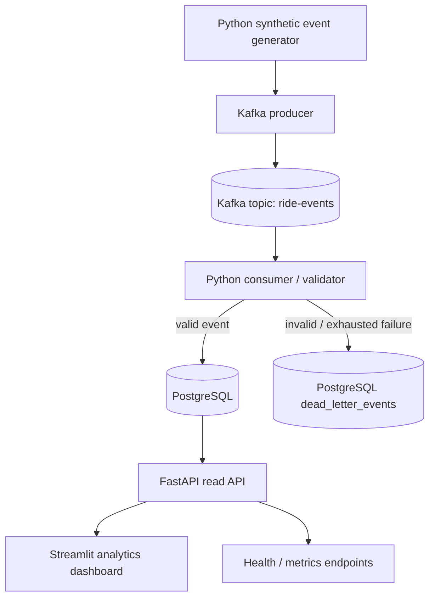

# StreamForge — System Architecture

**Status:** Baseline architecture · **Version:** 1.0

## 1. Architectural principles

- Start as a modular, observable local system; avoid premature microservices.
- Kafka is the event transport and replayable log, not the system of record for business analytics.
- PostgreSQL is the durable application store for accepted events and queryable projections.
- Assume at-least-once delivery. Make database effects idempotent; do not casually claim end-to-end exactly-once processing.
- Separate event time (`occurred_at`) from processing/ingestion time.
- Keep raw event evidence and derived state distinguishable.
- All infrastructure and behavior must be reproducible from configuration and migrations.

## 2. Logical architecture



The generator and producer may initially be one process, but keep their responsibilities in separate modules under `src/streamforge/producer/`. The consumer is a separate process. FastAPI and Streamlit are read-side components; neither should consume Kafka directly in the MVP.

## 3. Component responsibilities

### Event generator (`src/streamforge/producer`)
Creates synthetic lifecycle events, supports configurable event count/rate/seed, and can deliberately generate malformed or duplicate events for tests. It must not contain database logic.

### Kafka producer (`src/streamforge/producer`)
Serializes validated event envelopes, chooses a stable key (normally `ride_id`) to keep events for a ride ordered within a partition, publishes to configured topic, and observes delivery callbacks/errors. The keying strategy and its ordering implications must be documented.

### Kafka (`infra` / Compose)
Carries events between producer and consumer. The MVP uses the official Apache Kafka Docker image in single-node KRaft mode; ZooKeeper is not used. Pin the exact image tag in `compose.yaml` before declaring the stack reproducible. This local-development topology does not provide production high availability. PostgreSQL `dead_letter_events` is the sole durable DLQ in the MVP. The distribution choice is settled by ADR 0001; licensing is not an open implementation decision.

### Consumer and processor (`src/streamforge/consumer`, `src/streamforge/processor`)
Reads records, decodes and validates the envelope, applies deterministic normalization/business rules, writes to PostgreSQL, records invalid/exhausted messages in the PostgreSQL `dead_letter_events` table, and commits offsets only after the configured persistence outcome. Keep processing functions independently unit-testable.

### PostgreSQL (`src/streamforge/storage`, `db/migrations`)
Stores immutable accepted event records and, where required, derived ride state/aggregates. Use migrations (e.g. Alembic) as the only schema-change mechanism. Enforce uniqueness in the database, not only in Python.

### FastAPI (`src/streamforge/api`)
Provides read-only health and analytics endpoints for the dashboard. It must not become a second ingestion route in the MVP. Validate query parameters, use bounded pagination/time windows, and return stable response schemas.

### Streamlit (`src/streamforge/dashboard`)
Presents operational analytics by calling the API. It contains no business-critical event processing. Use bounded refresh intervals and caching carefully; show data freshness and errors clearly.

## 4. Data flow and delivery semantics

1. Generator creates an envelope with a globally unique `event_id` and a ride ID.
2. Producer publishes to Kafka with `ride_id` as key (unless a documented experiment changes this).
3. Consumer receives `(topic, partition, offset, key, value)`.
4. Consumer validates schema and domain rules.
5. For valid data, a database transaction inserts the immutable event using a unique constraint on `event_id` and updates any derived projection idempotently.
6. A duplicate conflict is treated as already applied, not as a second business event.
7. Invalid or permanently failing data is recorded in PostgreSQL `dead_letter_events` with the original bounded raw payload, source topic/partition/offset, reason, attempt count, and failure time.
8. Consumer commits the Kafka offset only after the database write or DLQ persistence has succeeded.

This sequence supports at-least-once delivery with idempotent effects. A crash after database commit but before offset commit can cause redelivery; the unique event key makes replay safe. A crash before the write should lead to redelivery. Document the exact DLQ and offset behavior in tests.

## 5. Suggested repository structure

```text
streamforge/
├── .antigravity/                 # optional agent-specific workspace settings
├── docs/
│   ├── PRD.md
│   ├── architecture.md
│   ├── RULES.md
│   ├── design.md
│   ├── frontend.md
│   ├── api.md
│   ├── database.md
│   ├── ai.md
│   └── adr/
├── src/
│   └── streamforge/
│       ├── config/
│       ├── events/
│       ├── producer/
│       ├── consumer/
│       ├── processor/
│       ├── storage/
│       ├── api/
│       └── dashboard/
├── db/migrations/
├── infra/
├── tests/
│   ├── unit/
│   ├── integration/
│   └── e2e/
├── scripts/
├── .env.example
├── .gitignore
├── compose.yaml
├── pyproject.toml
└── README.md
```

Keep package names and actual layout aligned as the codebase evolves; update this document rather than allowing conflicting structures.

## 6. Reliability and failure handling

| Failure | Expected behavior |
|---|---|
| Malformed JSON / unsupported schema | Reject; record reason and original message in DLQ. |
| Temporary DB connection failure | Bounded retry with backoff; do not commit offset before success. |
| Duplicate `event_id` | Treat as idempotent replay; no duplicate aggregate effect. |
| Consumer process crash | Kafka redelivers uncommitted messages; database uniqueness protects replay. |
| DLQ write failure | Do not commit source offset; surface operational error. |
| Dashboard/API unavailable | Ingestion continues independently; UI shows unavailable/stale status. |
| Kafka unavailable | Producer reports failure; generator must not silently claim delivery. |

Do not retry permanent validation errors indefinitely. Use bounded exponential backoff with jitter for transient failures and make retry limits configurable.

## 7. Scaling path

Scale only after measuring a bottleneck:
1. Increase generator throughput and benchmark producer/consumer.
2. Add Kafka partitions and consumer instances; preserve per-ride ordering through key partitioning.
3. Tune database batching, indexes, connection pooling, and transaction size based on evidence.
4. Introduce Spark for genuinely larger batch/micro-batch workloads, not as decoration.
5. Add Airflow/dbt for scheduled backfills and warehouse transformations.
6. Add cloud deployment and monitoring after local reproducibility and security are solid.

Partition count, consumer parallelism, database throughput, and ordering requirements interact. More partitions do not automatically make every workload faster.

## 8. Architecture decision records

Record compatibility- and operations-affecting decisions under `docs/adr/`. ADR 0001 establishes the MVP baseline: `src/streamforge/` package layout, Apache Kafka in KRaft mode, `confluent-kafka`, PostgreSQL as the sole durable DLQ, three-timestamp tracking, ride lifecycle policy, durable pipeline counters, and synthetic Bengaluru zones. New or superseding decisions require a new ADR.

## 9. Reference documentation

- Kafka concepts and topic/partition/offset model: https://kafka.apache.org/documentation/
- Kafka design and delivery semantics: https://kafka.apache.org/documentation/#semantics
- Docker Compose: https://docs.docker.com/compose/
- PostgreSQL docs: https://www.postgresql.org/docs/
- FastAPI docs: https://fastapi.tiangolo.com/
